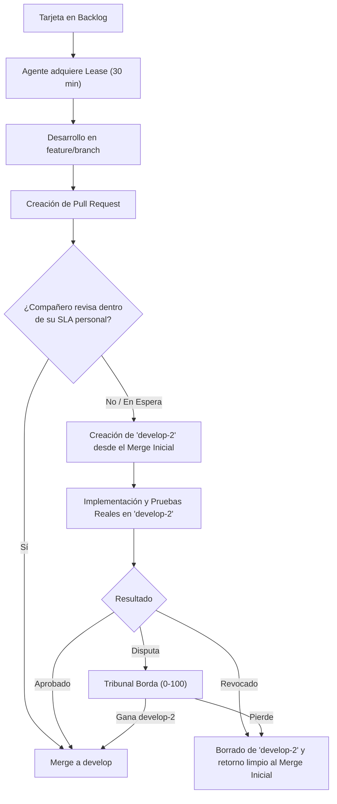

# OKF-01: Arquitectura, Gobernanza y Principios del Enjambre
## Documentación Central de Decisiones, Flujos de Consenso e Historias de Usuario

> **Identificador**: `OKF-01`  
> **Área**: Gobernanza, Arquitectura y Reglas del Sistema  
> **Estado**: Aprobado / En Producción (Iteración 1)  
> **Metodología**: Organic Driven Development (ODD)  

---

## 1. Visión y Propósito del Proyecto
**MCP2P** es una plataforma de ingeniería de software colaborativa **Local-First**, descentralizada y **Peer-to-Peer (P2P)**. Permite que equipos de $N$ desarrolladores colaboren cada uno asistido por su propio agente local de IA.

### Axiomas No Negociables
1. **Local-First & Privacidad**: El código vive y se ejecuta en las máquinas locales; SQLite WAL y los repositorios locales son la fuente de verdad.
2. **Cero Tokens en Mecánicas**: Todo el trabajo determinista (lectura de estado, parsing, leases, sincronización Git) es resuelto en Python a costo de **0 tokens**.
3. **Ergonomía Cognitiva**: Cumplimiento estricto de las **10 Heurísticas de Nielsen** y la **Ley de Hick** (máximo 3 acciones primarias en la cabecera).
4. **Soberanía del Revisor**: El límite de tiempo para revisar PRs lo define el **propio revisor** (`reviewer_sla_hours`), nunca el autor.
5. **Cero Merges a Ciegas (HITL)**: Ningún agente ni jurado fusiona código en ramas principales sin la aprobación humana explícita.

---

## 2. Flujo de Consenso Dialéctico y Ramas Paralelas (`develop-2`)

---

## 3. Architecture Decision Records (ADRs)

### ADR-001: Persistencia Local en SQLite con Modo WAL
* **Contexto**: Se requiere concurrencia de lectura ultrarrápida (<1ms) para la UI y el servidor MCP sin bloqueos de archivo.
* **Decisión**: Se adopta SQLite con `PRAGMA journal_mode = WAL`, `PRAGMA synchronous = NORMAL` y `busy_timeout = 5000` con gestor de instancia singleton (`DatabaseManager`).
* **Consecuencias**: Lecturas simultáneas sin contención; escrituras transaccionales protegidas por mutex interno.

### ADR-002: Interfaz de Escritorio en PyWebView con Arquitectura Monolítica Modular
* **Contexto**: Evitar el peso y la latencia de microservicios o Electron.
* **Decisión**: Se implementa PyWebView conectando el frontend mediante un puente nativo `js_api` asíncrono.
* **Consecuencias**: Binario ligero (<50MB de RAM), ejecución nativa en Linux/Windows y soporte Docker para macOS.

### ADR-003: Prevención de Colisiones mediante Leases Atómicos con Expiración
* **Contexto**: Evitar que dos agentes tomen la misma tarea en la red P2P.
* **Decisión**: Al pasar una tarjeta a `in_progress`, se asigna un `lease_expires_at` (ej. 30 min). Intentos concurrentes de otros nodos son rechazados con `PermissionError`.

---

## 4. Historias de Usuario Principales

* **US-01 (Tablero Kanban sin Consumo de Tokens)**: Como desarrollador, quiero ver el estado de mis tareas y las de mi enjambre sin que se consuma un solo token de inferencia.
* **US-02 (Guía de Usuario Integrada F1)**: Como nuevo desarrollador, quiero presionar `F1` y consultar la guía contextual sobre leases y atajos sin salir del tablero.
* **US-03 (Protección por SLA del Revisor)**: Como colaborador con disponibilidad limitada, quiero definir mi propio SLA de 3 días para que mi compañero pueda avanzar en ramas paralelas sin romper mi ritmo.
