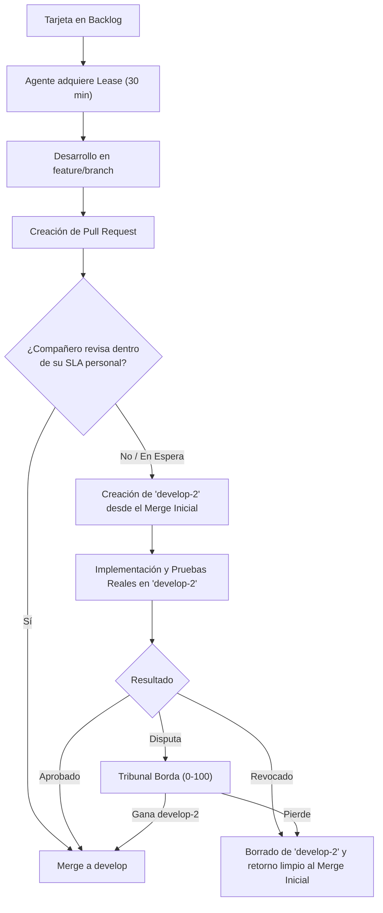

# OKF-01: Arquitectura, Gobernanza y Principios del Enjambre
## Documentación Central de Decisiones, Flujos de Consenso e Historias de Usuario

> **Identificador**: `OKF-01`  
> **Área**: Gobernanza, Arquitectura y Reglas del Sistema  
> **Estado**: Aprobado / En Producción (Iteración 1)  
> **Metodología**: Organic Driven Development (ODD)  

---

## 1. Visión y Propósito del Proyecto
**MCP2P** es una plataforma de ingeniería de software colaborativa **Local-First**, descentralizada y **Peer-to-Peer (P2P)**. Permite que equipos de $N$ desarrolladores colaboren cada uno asistido por su propio agente local de IA.

### Axiomas No Negociables
1. **Local-First & Privacidad**: El código vive y se ejecuta en las máquinas locales; SQLite WAL y los repositorios locales son la fuente de verdad.
2. **Cero Tokens en Mecánicas**: Todo el trabajo determinista (lectura de estado, parsing, leases, sincronización Git) es resuelto en Python a costo de **0 tokens**.
3. **Ergonomía Cognitiva**: Cumplimiento estricto de las **10 Heurísticas de Nielsen** y la **Ley de Hick** (máximo 3 acciones primarias en la cabecera).
4. **Soberanía del Revisor**: El límite de tiempo para revisar PRs lo define el **propio revisor** (`reviewer_sla_hours`), nunca el autor.
5. **Cero Merges a Ciegas (HITL)**: Ningún agente ni jurado fusiona código en ramas principales sin la aprobación humana explícita.

---

## 2. Flujo de Consenso Dialéctico y Ramas Paralelas (`develop-2`)

---

## 3. Architecture Decision Records (ADRs)

### ADR-001: Persistencia Local en SQLite con Modo WAL
* **Contexto**: Se requiere concurrencia de lectura ultrarrápida (<1ms) para la UI y el servidor MCP sin bloqueos de archivo.
* **Decisión**: Se adopta SQLite con `PRAGMA journal_mode = WAL`, `PRAGMA synchronous = NORMAL` y `busy_timeout = 5000` con gestor de instancia singleton (`DatabaseManager`).
* **Consecuencias**: Lecturas simultáneas sin contención; escrituras transaccionales protegidas por mutex interno.

### ADR-002: Interfaz de Escritorio en PyWebView con Arquitectura Monolítica Modular
* **Contexto**: Evitar el peso y la latencia de microservicios o Electron.
* **Decisión**: Se implementa PyWebView conectando el frontend mediante un puente nativo `js_api` asíncrono.
* **Consecuencias**: Binario ligero (<50MB de RAM), ejecución nativa en Linux/Windows y soporte Docker para macOS.

### ADR-003: Prevención de Colisiones mediante Leases Atómicos con Expiración
* **Contexto**: Evitar que dos agentes tomen la misma tarea en la red P2P.
* **Decisión**: Al pasar una tarjeta a `in_progress`, se asigna un `lease_expires_at` (ej. 30 min). Intentos concurrentes de otros nodos son rechazados con `PermissionError`.

### ADR-004: Pantalla Principal Hub de Proyectos y Aislamiento de Doble Repositorio
* **Contexto**: Iniciar directamente en un tablero Kanban genérico creaba ambigüedad sobre a qué proyecto pertenecían las tareas y no permitía gestionar múltiples repositorios.
* **Decisión**: La vista inicial de MCP2P es el **Hub de Proyectos**. Muestra la grilla de proyectos con sus nombres, `UUIDv4`, rutas de `app/` y `governance/` y la opción de crear nuevos. Al hacer doble clic en un proyecto, se abre su espacio de trabajo aislado (Kanban, OKF y agentes dedicados).
* **Consecuencias**: Modelo mental claro (Proyecto primero, Kanban después); cero contaminación cruzada de contextos entre diferentes APIs y repositorios.

### ADR-005: Servidor Local MCP y Leases Agénticos a Cero Tokens
* **Contexto**: Los agentes autónomos (Claude Code, Cursor, Antigravity IDE) necesitan interactuar con el sistema, crear tareas y coordinar trabajo sin consumir tokens innecesarios ni colisionar entre sí.
* **Decisión**: Implementación de un servidor MCP nativo (`mcp` SDK 2.x) ejecutándose sobre `stdio` exponiendo 7 herramientas deterministas conectadas a la base de datos SQLite WAL.
* **Consecuencias**: Cualquier IDE o agente conectado vía `mcp.json` puede listar proyectos, manipular tarjetas, solicitar leases atómicos y registrar su SLA de revisión de forma determinista y estandarizada.

### ADR-006: Canal A2A Híbrido: MessagePack para Señales y RFC de 3 Turnos para Dialéctica
* **Contexto**: Intercambiar mensajes en lenguaje natural para simples señales mecánicas (latidos, leases, cambios de estado) genera un desperdicio masivo de tokens. Por otro lado, negociar cambios arquitectónicos sin una estructura dialéctica genera bucles infinitos de conversación entre agentes.
* **Decisión**: Se implementa un bus A2A híbrido que separa:
  1. **Señales Informativas**: Codificadas en binario MessagePack a 0 tokens con latencia <1ms.
  2. **Coordinación Dialéctica**: Protocolo estricto de máximo 3 turnos (`PROPOSAL` -> `COUNTER_PROPOSAL` -> `RESOLUTION`), requiriendo análisis de impacto y señal de veredicto. Si no hay acuerdo al 3er turno, se escala al jurado.
* **Consecuencias**: Cero gasto de tokens en operaciones mecánicas y garantía de convergencia en las negociaciones sin loops infinitos.

### ADR-007: Gobernanza Desacoplada OKF y Memoria en Rama Huérfana Git
* **Contexto**: Mezclar la documentación viva de arquitectura y los logs de memoria conversacional en el repositorio de código principal contamina el historial de Git y los contextos de los agentes de software.
* **Decisión**: Aislamiento estricto de doble repositorio (`app/` y `governance/`). La memoria y contexto de los agentes se sincronizan en una rama huérfana aislada `orphan-conversa-memory-{project_uuid}` sin ensuciar la rama `main` o `develop`.
* **Consecuencias**: Cada agente puede leer y actualizar el contexto activo sin provocar conflictos de merge en el código fuente.

### ADR-008: Estandarización de Carpetas Doble Repo, Enlace de Invitación P2P y Código QR
* **Contexto**: Para que dos desarrolladores en plataformas distintas (ej. Linux y Windows) colaboren en el mismo proyecto sin fricción, las carpetas deben mantener nombres predecibles y sincronizables (`app_{nombre}` y `okf_{nombre}_{id}`), y debe ser trivial vincularse al proyecto sin configuraciones manuales complejas.
* **Decisión**:
  1. Cada proyecto genera automáticamente: `app_{nombre}` con `git init` y `okf_{nombre}_{id}` con `git init` y rama huérfana.
  2. Se implementa un generador de enlaces de invitación P2P (`mcp2p://join?token=...`) y renderizado directo de código QR SVG en el modal de configuración.
  3. El colaborador receptor se une con 1 clic ("Unirse vía P2P"), desplegando el mismo identificador UUID y estructura de repositorio en su equipo local.
* **Consecuencias**: Interoperabilidad multiplataforma inmediata, emparejamiento determinista de proyectos y cero discrepancias de rutas.

---

## 4. Historias de Usuario Principales

* **US-01 (Tablero Kanban sin Consumo de Tokens)**: Como desarrollador, quiero ver el estado de mis tareas y las de mi enjambre sin que se consuma un solo token de inferencia.
* **US-02 (Guía de Usuario Integrada F1)**: Como nuevo desarrollador, quiero presionar `F1` y consultar la guía contextual sobre leases y atajos sin salir del tablero.
* **US-03 (Protección por SLA del Revisor)**: Como colaborador con disponibilidad limitada, quiero definir mi propio SLA de 3 días para que mi compañero pueda avanzar en ramas paralelas sin romper mi ritmo.
* **US-04 (Coordinación Agéntica vía MCP)**: Como agente de IA conectado vía Model Context Protocol, quiero consultar y reclamar tareas del backlog de un proyecto de forma atómica para evitar duplicar esfuerzos con otros agentes o humanos.
* **US-05 (Debate Dialéctico Acotado A2A)**: Como agente colaborador, quiero debatir una propuesta técnica con el agente de mi compañero en un máximo de 3 turnos para alcanzar consenso rápido o escalar a arbitraje sin consumir tokens en bucles infinitos.
* **US-06 (Persistencia de Contexto en Rama Huérfana)**: Como agente de desarrollo, quiero registrar y recuperar el estado de la sesión en la rama huérfana de gobernanza sin alterar el historial de commits del código fuente.
* **US-07 (Emparejamiento y Compartición P2P mediante QR / Enlace)**: Como colaborador, quiero compartir mi proyecto mediante un enlace `mcp2p://` o código QR para que mi compañero se conecte y clone ambos repositorios de inmediato con permisos asignados.
* **US-08 (Mover Tarjetas Manualmente con Drag and Drop)**: Como usuario humano, quiero arrastrar tarjetas entre columnas en el tablero Kanban a mano, activando leases y transiciones de estado de forma visual e intuitiva.
