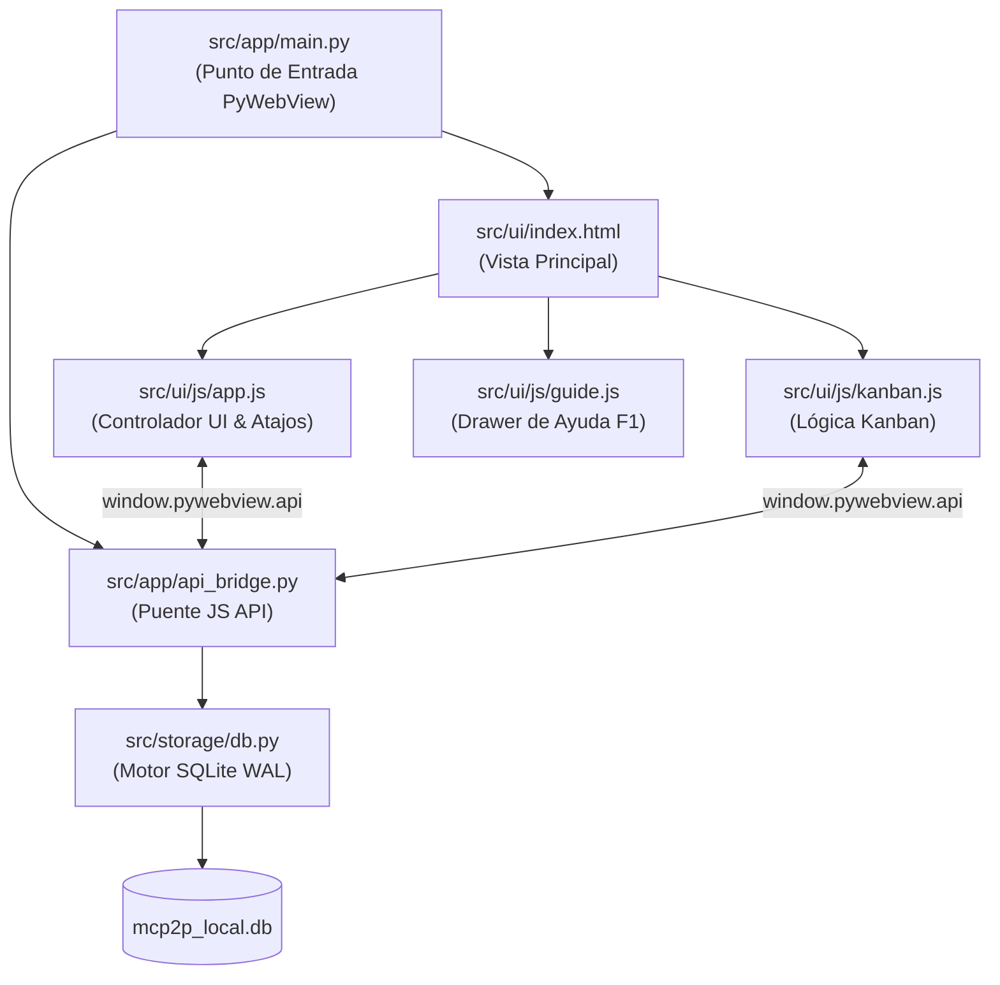

# OKF-02: Mapa de Código, Relación entre Componentes y Features
## Guía de Navegación Técnica para Agentes y Desarrolladores

> **Identificador**: `OKF-02`  
> **Propósito**: Mapa mental y grafo de dependencias para entender el código fuente sin leer archivos a ciegas.  
> **Versión Actual**: 0.1.0 (Iteración 1)  

---

## 1. Grafo de Dependencias entre Componentes

---

## 2. Mapa Detallado de Features y Referencias OKF

| Feature | Archivos Clave | Responsabilidad | Ficha Técnica Detallada |
| :--- | :--- | :--- | :--- |
| **Persistencia SQLite WAL** | [`src/storage/db.py`](src/storage/db.py) | Inicialización DDL, modo WAL, transacciones ACID, leases de tareas y registro de nodos. | 📄 [Ver Documentación Backend: `storage_sqlite.md`](docs/okf/backend/storage_sqlite.md) |
| **Puente JS API (PyWebView)** | [`src/app/api_bridge.py`](src/app/api_bridge.py) | Métodos asíncronos expuestos a JavaScript, control de excepciones y nodo local por defecto. | 📄 [Ver Documentación Backend: `api_bridge.md`](docs/okf/backend/api_bridge.md) |
| **Punto de Entrada de Escritorio** | [`src/app/main.py`](src/app/main.py) | Configuración de ventana de 1280x840, soporte `--headless`, argumentos CLI y cierre limpio. | 📄 [Ver Documentación Backend: `api_bridge.md`](docs/okf/backend/api_bridge.md) |
| **Sistema Visual y Temas** | [`src/ui/css/themes.css`](src/ui/css/themes.css), [`app.js`](src/ui/js/app.js) | Paleta dual Claro/Oscuro, tokens CSS, contraste WCAG AAA, atajo `Ctrl+D`. | 📄 [Ver Documentación Frontend: `theme_system.md`](docs/okf/frontend/theme_system.md) |
| **Guía de Usuario Integrada** | [`src/ui/js/guide.js`](src/ui/js/guide.js), [`index.html`](src/ui/index.html) | Panel lateral deslizante (Heurística 10 de Nielsen), atajo `F1`, tabla de atajos. | 📄 [Ver Documentación Frontend: `user_guide_drawer.md`](docs/okf/frontend/user_guide_drawer.md) |
| **Tablero Kanban & Leases** | [`src/ui/js/kanban.js`](src/ui/js/kanban.js) | Renderizado en 4 columnas, insignias de lease activo, asignaciones y contadores dinámicos. | 📄 [Ver Documentación Frontend: `user_guide_drawer.md`](docs/okf/frontend/user_guide_drawer.md) |

---

## 3. Instrucciones de Carga para un Agente de IA

Cuando un agente autónomo comience una tarea de desarrollo en este repositorio:
1. **Paso 1**: Leer [`01_ARQUITECTURA_Y_GOBERNANZA.md`](docs/okf/01_ARQUITECTURA_Y_GOBERNANZA.md) para internalizar los axiomas del proyecto.
2. **Paso 2**: Consultar este archivo (`02_MAPA_DE_CODIGO_Y_FEATURES.md`) para identificar los módulos involucrados.
3. **Paso 3**: Abrir la ficha técnica específica en `backend/` o `frontend/` correspondiente a la feature que va a modificar.
4. **Paso 4**: Ejecutar la suite de pruebas con `PYTHONPATH=. .venv/bin/pytest tests/` antes y después de cualquier cambio.
