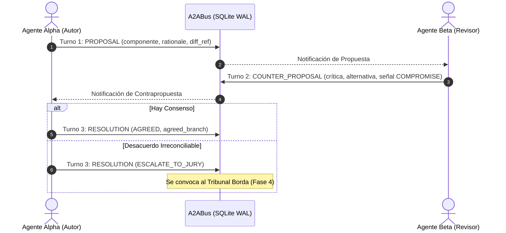

# Ficha Técnica: Bus de Comunicación A2A Híbrido
> **Área**: Backend  
> **Identificador**: `a2a_bus`  
> **Código Fuente**: [`src/a2a/bus.py`](../../../src/a2a/bus.py)  
> **Documento OKF de Referencia**: [`02_MAPA_DE_CODIGO_Y_FEATURES.md`](../02_MAPA_DE_CODIGO_Y_FEATURES.md)

---

## 1. Resumen y Propósito
El módulo **A2A Bus** (`A2ABus`) implementa el canal de comunicación híbrido Agente a Agente (A2A) para la plataforma MCP2P. Combina dos estrategias de transporte para balancear velocidad, costo y riqueza semántica:
1. **Canal INFORMATIVO (0 Tokens)**: Empaquetamiento binario ultrarrápido con **MessagePack** (`msgpack`) para señales mecánicas, latidos (`HEARTBEAT`), reclamo de tareas (`TASK_CLAIMED`) y telemetría del sistema.
2. **Canal de COORDINACIÓN (RFC Dialéctico de 3 Turnos)**: Máquina de estados estructurada para debates técnicos entre agentes antes de escribir código o abrir Pull Requests:
   - **Turno 1 (`PROPOSAL`)**: Propuesta formal que especifica componente, intención, justificación técnica, referencia a diff y análisis de impacto.
   - **Turno 2 (`COUNTER_PROPOSAL`)**: Respuesta del par con crítica constructiva, alternativa y señal de veredicto (`ACCEPT`, `REJECT` o `COMPROMISE`).
   - **Turno 3 (`RESOLUTION`)**: Decisión final vinculante (`AGREED` o `ESCALATE_TO_JURY`) acordando la rama de trabajo o convocando al tribunal Borda.

---

## 2. Diagrama de Secuencia del RFC Dialéctico

---

## 3. Patrón Outbox y Persistencia
Cada mensaje A2A emitido:
- Se persiste en la tabla `a2a_messages` vinculada al `project_uuid` para auditoría y visualización en el frontend.
- Se encola en `outbox_events` con estado `pending` para sincronización asíncrona P2P entre máquinas colaboradoras.
- Se despacha en memoria a los suscriptores locales (`subscribe` / `unsubscribe`).

---

## 4. Métodos Clave de la API en Python

| Método | Argumentos | Retorno | Descripción |
| :--- | :--- | :--- | :--- |
| `pack_binary` | `data: dict` | `bytes` | Serializa un diccionario en formato binario MessagePack a costo 0 de tokens. |
| `unpack_binary` | `raw_bytes: bytes` | `dict` | Deserializa bytes MessagePack a diccionario nativo. |
| `send_informative` | `project_uuid, sender_node_uuid, signal_type, data, card_id` | `dict` | Envía una señal operativa a 0 tokens y la encola en outbox. |
| `send_proposal` | `project_uuid, sender_node_uuid, session_id, component, intent, rationale, diff_ref, impact` | `dict` | Emite el Turno 1 del RFC Dialéctico. |
| `send_counter_proposal` | `project_uuid, sender_node_uuid, session_id, critique, alternative, verdict_signal` | `dict` | Emite el Turno 2 (valida existencia de Turno 1 previo). |
| `send_resolution` | `project_uuid, sender_node_uuid, session_id, final_decision, synthesis_notes, agreed_branch` | `dict` | Emite el Turno 3 de cierre o escalado. |
| `get_session_turns` | `project_uuid, session_id` | `List[dict]` | Obtiene el historial completo de turnos ordenados cronológicamente. |
